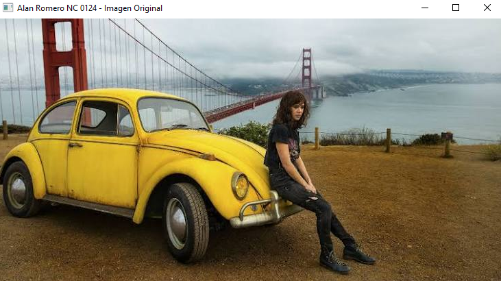
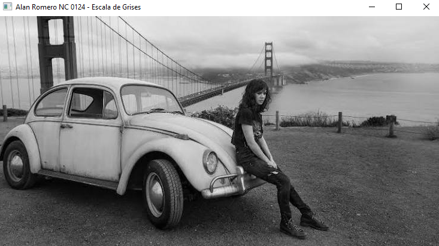
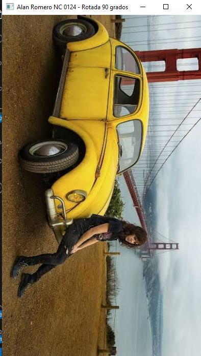
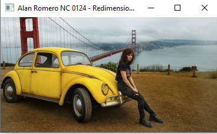
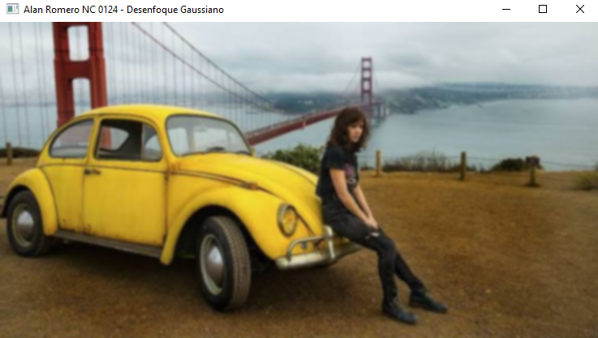
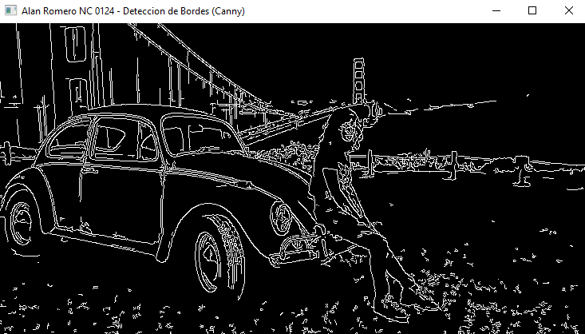
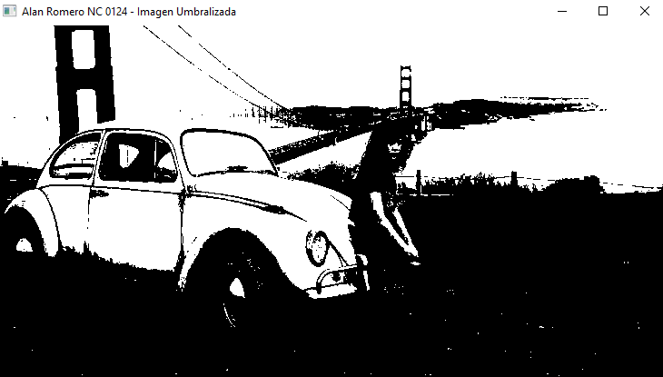
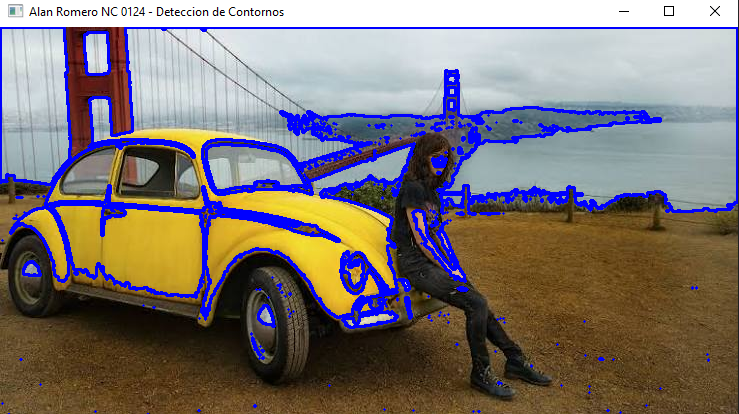
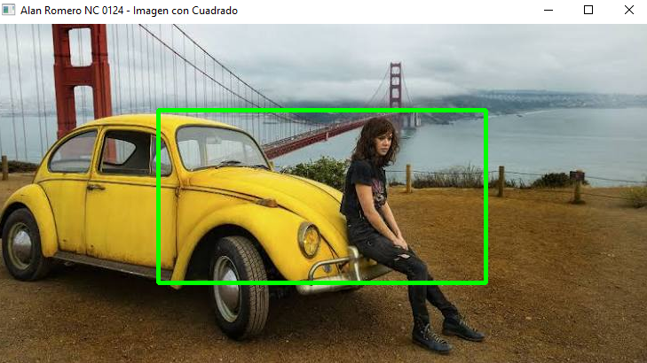

## Alan Romero NC 0124
## imagen original 

## Imagen a escala a grises

## imagen rotada 90 grados

## Imagen Redimensionada

## desenfoque gaussani

## deteccion de bordes

## Aplicar umbralización binaria

##  Detección de contornos

## Dibujar formas y añadir texto
